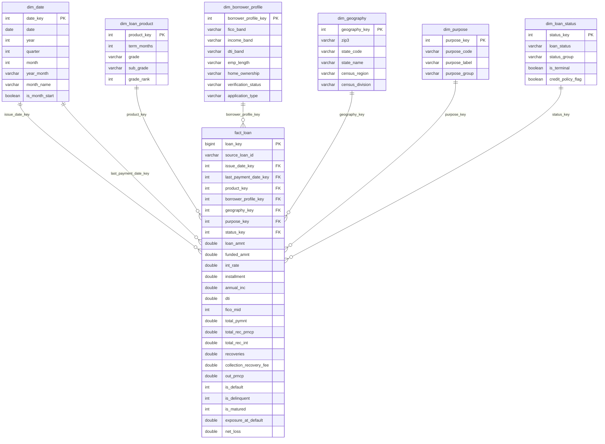

# Data dictionary — Phase 1 star schema

The warehouse is a DuckDB file. Analytical tables live in the `marts` schema.
`staging.load_rejections` keeps the rows removed from the source, with a reason
and no free-text fields. Rejected *applications* (`fact_loan_application_rejected`)
are out of scope.

The as-of date for maturity is **2019-03-31**. Originations in the Kaggle extract
run through 2018Q4 and the file was published in early 2019. A fixed snapshot
keeps default rates reproducible. `is_matured` is 1 when `issue_d + term` is on
or before that date. It is not the same thing as "the loan has a terminal status":
an early charge-off of a vintage that has not reached contractual maturity stays
`is_matured = 0`, so it does not dilute the matured-loan default rate and it is
also not hidden from the charge-off amount.

## Source

| Item | Value |
|---|---|
| Dataset | [LendingClub accepted and rejected loans](https://www.kaggle.com/datasets/wordsforthewise/lending-club), file `accepted_2007_to_2018Q4.csv` |
| Licence note | The Kaggle page marks the upload CC0. The pipeline does not commit the extract or the warehouse. |
| Expected shape | 2,260,701 data rows, 151 columns. `make build` warns if the canonical filename does not match; it still loads. |
| Grain of the extract | One row per accepted (issued) loan, as of the publisher's snapshot |

Only the columns below are read. `desc`, `emp_title`, `title`, and `url` are never
selected. `member_id` is not selected. `id` is kept as `source_loan_id` for
lineage and is not a business key to show in a later UI.

| Source column | Warehouse use |
|---|---|
| `id` | `fact_loan.source_loan_id` (string; not cast through a float) |
| `loan_amnt` | `fact_loan.loan_amnt` |
| `funded_amnt` | `fact_loan.funded_amnt`. Rows with a missing or negative value are rejected. |
| `term` | `dim_loan_product.term_months`. The text is usually `" 36 months"` or `" 60 months"`. Anything else is rejected. |
| `int_rate` | `fact_loan.int_rate`, in percentage points (`13.56` means 13.56%). A trailing `%` is stripped. Blank stays null and is left out of the weighted average. |
| `installment` | `fact_loan.installment` |
| `grade`, `sub_grade` | `dim_loan_product`. If `grade` is blank and `sub_grade` starts with A–G, the grade is taken from that letter. Otherwise a missing grade is `Unknown`. |
| `emp_length` | `dim_borrower_profile.emp_length`. Blank and `n/a` become `Unknown`. |
| `home_ownership` | Upper-cased. Blank becomes `Unknown`. `ANY`, `NONE`, and `OTHER` are kept. |
| `annual_inc` | Numeric on the fact, and `income_band` on the profile. |
| `verification_status` | `Verified`, `Source Verified`, `Not Verified`, or `Unknown`. |
| `issue_d` | Issue month, parsed as `Mon-YYYY` (for example `Dec-2018`) to the first of that month. Unparseable values are rejected. |
| `loan_status` | `dim_loan_status`, plus the default and delinquency flags on the fact. |
| `purpose` | `dim_purpose`. Blank becomes code `unknown`. |
| `zip_code` | First three digits, stored as `zip3`. The source is already truncated (`941xx`). |
| `addr_state` | `state_code`, upper-cased. |
| `dti` | Numeric on the fact, and `dti_band` on the profile. Negative values are banded as `Unknown` and the loan is kept. |
| `fico_range_low`, `fico_range_high` | `fico_mid = round((low + high) / 2)`. |
| `total_pymnt`, `total_rec_prncp`, `total_rec_int`, `recoveries`, `collection_recovery_fee`, `out_prncp` | Stored as parsed numbers. Blank stays null on the fact. Loss formulas treat a null component as 0. |
| `last_pymnt_d` | `last_payment_date_key`. Blank stays null. There is no dummy date. |
| `application_type` | `Individual`, `Joint App` (`Joint App` or `JOINT`), or `Unknown`. |

## Rows removed before the fact

Every source row is either one `fact_loan` row or one `staging.load_rejections` row.
The first matching reason wins:

| Reason | Rule |
|---|---|
| `missing_loan_id` | `id` is blank |
| `missing_issue_date` | `issue_d` is not `Mon-YYYY` |
| `missing_loan_status` | `loan_status` is blank |
| `missing_funded_amnt` | `funded_amnt` is blank or not a number |
| `negative_funded_amnt` | `funded_amnt < 0` |
| `invalid_term` | term is not 36 or 60 months |
| `duplicate_loan_id` | a later row with the same `id`, after the filters above |

Duplicates keep the earliest row in the file. The CSV is read on one thread so that order is the file order. A structurally invalid CSV fails the build (`strict_mode`) instead of dropping lines quietly. That keeps the row-count check meaningful.

`marts.pipeline_audit` stores the snapshot date, the source file name (not the full path), and the three row counts. `marts.load_rejection_summary` stores the reason counts.

## Star schema



Surrogate keys are assigned by sorting the natural key, so a second build of the same file produces the same keys. `date_key` is `YYYYMMDD`. The calendar is one row per day from the earliest issue or payment month through the later of the snapshot date and the latest observed month. Days with no loan are still present, which is what a date dimension is for. `last_payment_date_key` is null when `last_pymnt_d` is blank; a null foreign key is not an orphan.

`dim_borrower_profile` stores the band combination, not the raw income, DTI, or FICO. Those numbers stay on the fact so averages can still be computed. Missing attributes are the literal `Unknown` (or `UNK` for a missing zip or state code), so the foreign key is always populated.

### `dim_loan_product`

`grade_rank` is 1 for A through 7 for G, and null for `Unknown`. The row is the observed `(term_months, grade, sub_grade)`, not the full cartesian product.

### `dim_borrower_profile` bands

| Attribute | Bands |
|---|---|
| `fico_band` | `<660`, then 20-point bands from `660-679` through `780-799`, then `800+`. Null FICO is `Unknown`. |
| `income_band` | `<30k`, `30-49k`, `50-74k`, `75-99k`, `100-149k`, `150-199k`, `200k+`. Null or negative income is `Unknown`. Cuts are the lower bound of the next band (`50000` is `50-74k`). |
| `dti_band` | `<10`, `10-19`, `20-29`, `30-39`, `40+`. Null or negative DTI is `Unknown`. `10` is `10-19`. |
| `emp_length` | LendingClub's labels: `< 1 year`, `1 year`, `2 years` … `9 years`, `10+ years`, or `Unknown`. |
| `home_ownership` | Upper-cased source value, or `Unknown`. |
| `verification_status` | `Verified`, `Source Verified`, `Not Verified`, or `Unknown`. |
| `application_type` | `Individual`, `Joint App`, or `Unknown`. |

### `dim_geography`

State names and Census regions follow the Census Bureau regions and divisions for the 50 states and the District of Columbia. `AA`, `AE`, and `AP` are stored as Armed Forces / Overseas Military so those loans are not dropped and are not labelled as a Census division. An unrecognised state code is kept with `state_name`, `census_region`, and `census_division` set to `Unknown`.

### `dim_purpose`

| `purpose_group` | Codes |
|---|---|
| Debt | `debt_consolidation`, `credit_card` |
| Home | `home_improvement`, `house` |
| Consumer | `car`, `major_purchase`, `medical`, `moving`, `vacation`, `wedding`, `educational` |
| Business | `small_business`, `renewable_energy` |
| Other | `other`, `unknown`, and any code that is not in the list above |

### `dim_loan_status`

The map is `reference/loan_status.csv`. A status that is not in that file is kept as `status_group = Unknown`, `is_terminal = false`, `credit_policy_flag = false`, and it is **not** counted as default or delinquent.

| `loan_status` | `status_group` | Terminal | Credit-policy exception | Default | Delinquent |
|---|---|---|---|---|---|
| Fully Paid | Closed-Paid | yes | no | no | no |
| Does not meet the credit policy. Status:Fully Paid | Closed-Paid | yes | yes | no | no |
| Charged Off | Default | yes | no | yes | no |
| Default | Default | yes | no | yes | no |
| Does not meet the credit policy. Status:Charged Off | Default | yes | yes | yes | no |
| Current | Performing | no | no | no | no |
| Issued | Performing | no | no | no | no |
| In Grace Period | Delinquent | no | no | no | yes |
| Late (16-30 days) | Delinquent | no | no | no | yes |
| Late (31-120 days) | Delinquent | no | no | no | yes |

`is_default` and `is_delinquent` are copied onto `fact_loan` so the core rates do not need a join. `is_matured` depends on the issue date and the term, so it exists only on the fact.

### Loss columns

For a default (`is_default = 1`):

```text
exposure_at_default = funded_amnt - coalesce(total_rec_prncp, 0)
net_loss            = exposure_at_default - coalesce(recoveries, 0) + coalesce(collection_recovery_fee, 0)
```

Both are 0 when `is_default = 0`. The formula is not floored at zero: if principal received exceeds the funded amount, exposure can be negative and the quality check expects that exact expression.

## Metrics

These queries are the definitions in `credit_risk_agent.metrics`. They read `marts` only.
Interest rates stay in percentage points. Default, charge-off, delinquency, recovery, LGD, and net-loss rates are decimals (`0.05` = 5%).

| Metric | Definition |
|---|---|
| `loan_count` | `COUNT(*)` on `fact_loan` |
| `funded_volume` | `SUM(funded_amnt)` |
| `avg_interest_rate` | `AVG(int_rate)` |
| `weighted_avg_interest_rate` | `SUM(int_rate * funded_amnt) / SUM(funded_amnt)` over rows with a non-null rate |
| `default_rate_matured` | `SUM(is_default) / COUNT(*)` where `is_matured = 1` |
| `charge_off_rate` | `SUM(exposure_at_default) / SUM(funded_amnt)` on all fact rows, not only matured loans |
| `delinquency_rate_active` | `SUM(is_delinquent) / COUNT(*)` where `status_group` is Performing or Delinquent |
| `delinquency_rate_balance` | `SUM(out_prncp)` for delinquent loans in that same active set, divided by `SUM(out_prncp)` for the active set |
| `recovery_rate` | `SUM(recoveries) / SUM(exposure_at_default)` |
| `lgd_realised` | `1 - (SUM(recoveries) - SUM(collection_recovery_fee)) / SUM(exposure_at_default)` |
| `net_loss_rate` | `SUM(net_loss) / SUM(funded_amnt)` |

`expected_loss_proxy` (historical PD for the same grade and term, times a realised LGD, times current `out_prncp`) is not built in Phase 1. It is a semantic-layer calculation, and it is not an IFRS 9 or Basel expected-loss model.

The Phase 1 tests recompute `loan_count`, `funded_volume`, `weighted_avg_interest_rate`, `default_rate_matured`, and `charge_off_rate` in pandas from the raw fixture and require the star-schema queries to match.

## Design notes versus the project spec

- Transformations are SQL executed by DuckDB (`staging` then `marts`), with pytest covering uniqueness, nulls, foreign keys, row accounting, and the metric tie-out. A dbt project would repeat that layout later; it is not a second toolchain in this phase.
- The rejected-application fact is omitted.
- Missing borrower, purpose, product, and geography attributes are explicit dimension members. The last payment date is the one nullable foreign key.
- The date spine is bounded by the data and the snapshot.
- Armed Forces mail codes are included.
- Unknown loan statuses are retained and are not treated as defaults.
